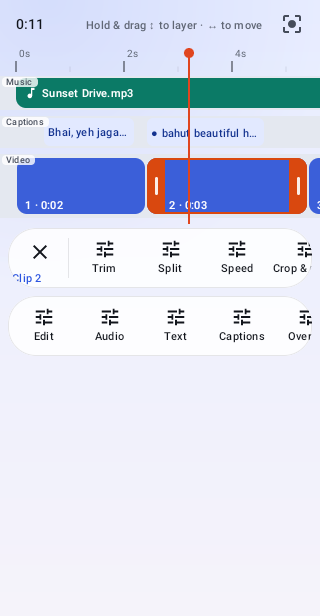
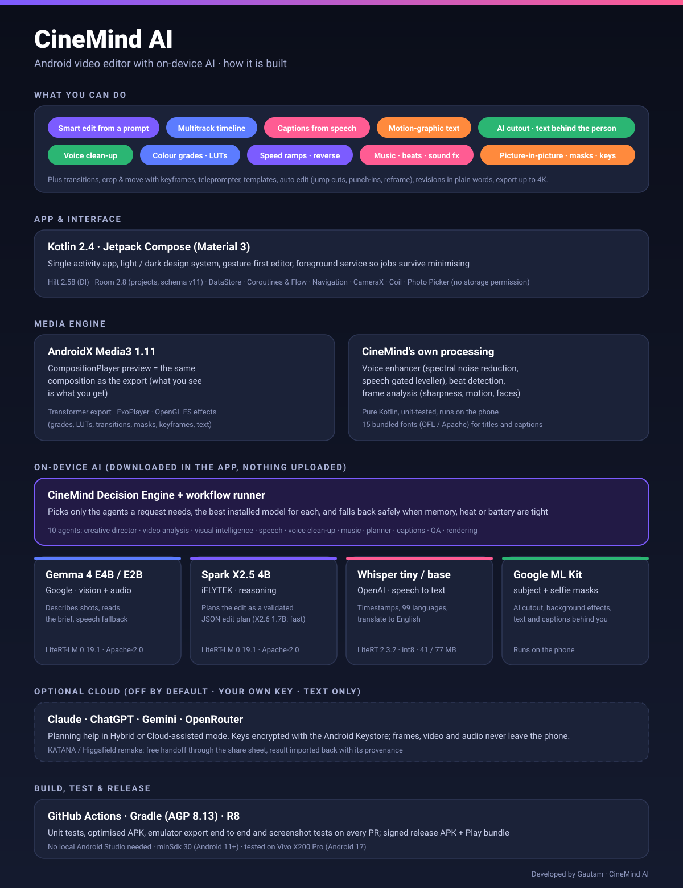

# CineMind AI

**A video editor for Android with on-device AI.** Edit by hand on a multitrack timeline, or describe the reel you want and let CineMind build an editable first cut, all on your phone. Your videos never leave the device.

## What you can do

| | |
|---|---|
| ✦ **Smart edit from a prompt** | *"30-second cinematic travel reel, clear voices, subtitles"* becomes a new, fully editable project. Revise it in plain words: *"make it 15 s, keep the music"*. |
| 🎬 **Multitrack editing** | Trim, split, reorder, speed ramps, reverse, freeze, crop & move with keyframes, picture-in-picture, masks, green screen, and 1-tap Fit / Fill. |
| 💬 **Captions from speech** | Whisper on the phone, Hinglish / native script / English, 13 styles, karaoke, word by word, and captions behind the person. |
| ✍️ **Motion-graphic text** | 15 fonts, gradients, 3D depth, glow, 14 entrances, looping effects, motion paths, a progress bar, and text behind the subject. |
| ✂️ **AI cutout** | Remove, blur or colour-pop the background, spotlight or outline the subject. Runs on the phone. |
| 🎙 **Voice clean-up** | Removes background noise and evens out voices (Light / Strong), in the preview and the export. |
| 🎨 **Colour** | Looks, LUT packs, adjustments and AI suggestions. |
| 🎵 **Audio** | Music with beat sync, sound effects, voiceover, voice from text. |
| ⚡ **Auto edit** | Jump cuts on pauses, punch-ins on emphasis, and auto-reframe for talking videos. |
| 📜 **Teleprompter, templates** | Record while reading your script, or start from a ready-made structure. |
| 📤 **Export** | 720p to 4K, 24 to 60 fps, MP4. Keeps running when the app is minimised. |

## How it is built

* **App:** Kotlin, Jetpack Compose (Material 3), Hilt, Room, DataStore, Coroutines.
* **Media:** AndroidX Media3 (CompositionPlayer preview = the export composition, Transformer, OpenGL effects), plus CineMind's own voice enhancer, beat detection and frame analysis.
* **On-device AI** (downloaded in the app, checksum-verified, kept through updates):

  | Model | Role | Runtime |
  |---|---|---|
  | Gemma 4 E2B / E4B (Google) | vision + audio | LiteRT-LM 0.19.1 |
  | Spark X2.5 4B (iFLYTEK) | edit planning (reasoning) | LiteRT-LM 0.19.1 |
  | Whisper tiny / base (OpenAI) | speech to text with timestamps | LiteRT 2.3.2 |
  | ML Kit | subject and selfie segmentation | Google Play services |

* **Decision engine:** 10 agents, a workflow runner (parallel, pipeline, conditional, dynamic), model choice per skill, and fallbacks for memory, heat and battery.
* **Optional cloud:** Claude, ChatGPT, Gemini and OpenRouter, with the user's own key. Text only.
* **Build:** GitHub Actions only (unit tests, R8 build, emulator export and screenshot tests). minSdk 30.

## Documentation

| Doc | For |
|---|---|
| [User guide and tutorials](docs/USER_GUIDE.md) | People using the app |
| [AI orchestration](docs/AI_ORCHESTRATION.md) | Agents, models, workflow engine, diagnostics |
| [Motion graphics](docs/MOTION_GRAPHICS.md) | Text, cutout, auto edit |
| [AI providers](docs/AI_PROVIDERS.md) | Cloud services and the KATANA handoff |
| [Play release](docs/PLAY_RELEASE.md) | Upload key, Play Console, Data Safety |
| [Privacy policy](docs/PRIVACY_POLICY.md) | Users and Google Play |
| [Project status](docs/PROJECT_STATUS.md) | Developers: history, decisions, what's next |

## Building

Every build runs in GitHub Actions. You don't need Android Studio locally. Open a pull request, or run the **CI** workflow by hand: it produces a debug APK and an optimised APK. On `main`, once the signing secrets are set, it also produces a signed release APK and a Play bundle (see [PLAY_RELEASE.md](docs/PLAY_RELEASE.md)).

---

Developed by Gautam.
