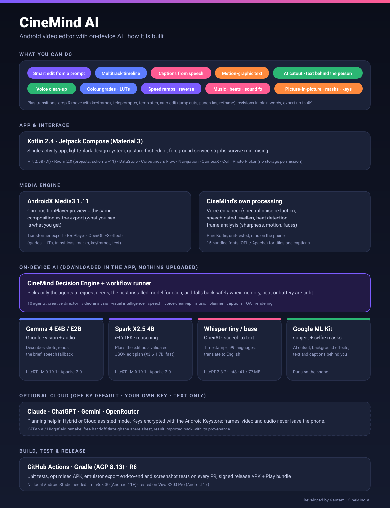
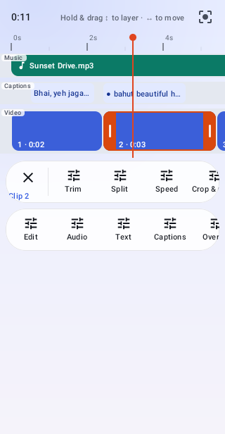
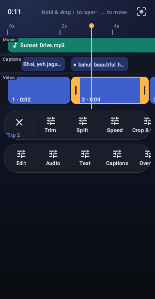

# CineMind AI — User Guide

CineMind AI is a video editor for Android phones. You can edit by hand on a multitrack timeline, or describe the video you want and let the on-device AI build an editable first cut. Every AI change stays editable, and your videos never leave your phone.

**Contents**

1. [Getting started](#1-getting-started)
2. [Tutorial: your first edit by hand](#2-tutorial-your-first-edit-by-hand)
3. [Tutorial: an AI edit from a prompt](#3-tutorial-an-ai-edit-from-a-prompt)
4. [Tutorial: captions from speech](#4-tutorial-captions-from-speech)
5. [Tutorial: motion-graphic titles and text behind you](#5-tutorial-motion-graphic-titles-and-text-behind-you)
6. [Tutorial: clean up noisy voices](#6-tutorial-clean-up-noisy-voices)
7. [Every tool in the editor](#7-every-tool-in-the-editor)
8. [AI models: on the phone and in the cloud](#8-ai-models-on-the-phone-and-in-the-cloud)
9. [Exporting and sharing](#9-exporting-and-sharing)
10. [Privacy](#10-privacy)
11. [Troubleshooting](#11-troubleshooting)

---

## 1. Getting started

**Requirements:** Android 11 or newer. For the on-device AI models, a phone with 8 GB of RAM or more works best (CineMind is tested on a Vivo X200 Pro).

When you open the app you land on **Home**:

| Home (fresh install) | Settings |
|---|---|
|  |  |

From Home you can:

* **New project:** pick videos and photos, then edit.
* **✦ AI edit:** pick your clips, then describe the reel you want.
* **Start from a template:** a ready-made structure you fill with your shots.
* **Record with the teleprompter:** read your script while the camera records.
* **✦ (top right):** AI models. Download the on-device models or connect a cloud service.
* **⚙ (top right):** Settings: theme (light, dark, system), AI options, feedback, diagnostics and About.

---

## 2. Tutorial: your first edit by hand

1. On Home, tap **New project**.
2. Pick your clips in the order you want them. The numbers show the order. Tap **Import**.

   

3. The editor opens: the preview is on top, the timeline below, and the tools at the bottom.

    

   * **Music** sits on top, **captions and titles** in their own lanes, and **video** at the bottom.
   * Drag the timeline to scrub. Pinch it to zoom.
   * Tap a clip to select it. The bottom bar then shows only that clip's actions: Trim, Split, Speed, Crop & move, Colour, Transition, Freeze, Reverse, Move left / right, Delete.
4. **Trim:** drag the yellow handles at the ends of the selected clip.
5. **Split:** put the playhead where you want the cut and tap **Split**.
6. **Reorder:** use **Move left / Move right**.
7. **Add a transition:** tap **Transitions** and choose fade, slide, zoom, cross-dissolve and more.
8. **Add music:** go to **Audio → Music**. You can set the start point, loop, volume and fades, and sync cuts to the beat.
9. Tap **Export** (top right). See [section 9](#9-exporting-and-sharing).

Undo and Redo are always in the top bar. Hold a lane and drag it up or down to change what is in front (titles, captions, picture-in-picture).

---

## 3. Tutorial: an AI edit from a prompt

1. On Home, tap **✦ AI edit**, pick your clips and tap **Import**.
2. Describe the video. For example:
   > *A 30-second cinematic travel reel, emotional music feel, slow-motion on the best shots, clear voices, subtitles.*

   Or open the **prompt library**: 28 ready-made briefs in 8 genres. You can search them, mark favourites, and save your own prompts.

   Under the prompt box:

   * **🎤 Speak:** say what you want, in any language. With Whisper installed it is transcribed on the phone, and Hindi or Hinglish becomes an English prompt. Without Whisper, the phone's own recogniser is used. There's also a mic on **Change this edit**.
   * **🎬 Sample video:** a video whose style you like (*"make it like this"*). CineMind measures how fast it cuts, how much it moves and its look, and sets the pacing to match.
   * **🖼 Image:** a picture with the look you want (light, colours, mood).

   You can add up to 4 references. Only your own clips are edited: a reference only steers pace and look. References are studied on the phone, nothing is uploaded or copied, and with a vision model installed the AI also describes them in one sentence.
3. Tap **Create**. CineMind's decision engine runs only the agents your request needs, and shows the progress as it goes:
   * **Video analysis** measures sharpness, motion, exposure and faces in every clip.
   * **Visual intelligence** (Gemma) describes the key frames.
   * **Creative director** and **Editing planner** (Spark X2.5 4B when installed) write the edit plan. CineMind checks the plan against your real footage before using it.
   * **Voice clean-up** removes background noise. It uses stronger removal when you mention noise, wind or traffic.
   * **Speech** (Whisper) transcribes the speech, and **Captions** turns it into subtitles timed to the new cut.
   * **Quality check** and **Rendering** build a **new, fully editable project**. Your original project is never changed.
4. Read **How this was made** to see what each agent did, then open the project and change anything you like.
5. Not quite right? Use **Change this edit** and say it in plain words: *"make it 15 seconds, keep the music"*. CineMind makes a new version from the original footage, reruns only the agents it needs, and keeps what you asked to keep.

**Without any AI model installed**, Smart edit still works. It uses CineMind's built-in rules and measurements.

**Auto edit** (AI → Auto edit) handles talking videos in one tap: it removes pauses (jump cuts), adds punch-ins on emphasis, and reframes around the speaker.

---

## 4. Tutorial: captions from speech

1. In the editor, tap **Captions** (or **AI → Auto captions**).
2. Choose how the words are written:
   * **Hinglish / Roman:** Hindi in English letters.
   * **Native script:** for example Devanagari.
   * **English translation.**
3. CineMind transcribes on the phone, with Whisper when it's installed, otherwise with Gemma or Android's recogniser.
4. Pick a style. There are 13 presets (Reels, Hype, Comic, Cinematic, Podcast, Hindi and more), and you can change the font, size, colours, outline, box and position.
5. Choose sentence, phrase or word-by-word display, karaoke highlight, and an animation.
6. Tap any caption to correct its text or timing. A ● marks words the recogniser wasn't sure about.

The captions are burned into the exported video exactly as they look in the preview:

**Captions behind the person:** turn this on in the caption style. When the clip has a cutout (AI → Cut out subject), the words sit behind whoever is in the shot.

---

## 5. Tutorial: motion-graphic titles and text behind you

1. Tap **Text → Text & stickers**. Choose a look: 12 title looks and 6 caption looks, using 15 bundled fonts (including Devanagari).
2. Type your words. Drag the title on the preview to move it, pinch to resize, and twist to rotate.
3. Open the title to style it:
   * **Words & look:** font, weight, letter spacing, alignment, size and angle.
   * **Colour & effects:** colour, gradient, outline, shadow or glow, box, 3D depth, and **Behind the person**.
   * **Animation:** 14 entrances (letter drop, word by word, wipe, stamp, glitch…), exits, and 6 loops that keep moving (pulse, shake, wave, float, neon flicker, glitch). There's also a motion path: the text glides from where it starts to where you put it.
   * **Timing:** when the text starts and ends.
4. **Text behind the person:** run **AI → Cut out subject** on the clip, then turn on **Behind the person**. The title now sits between the background and you.
5. **Picture-in-picture order:** when a title overlaps picture-in-picture clips, *Words & look → Picture-in-picture* lets you put it **in front of** or **behind** each overlay separately.
6. **Smart graphics** suggests titles and callouts that fit your video.
7. **Progress bar:** a bar that fills as the video plays (Text → add progress bar).

**AI cutout** (**Edit → Cutout**, or **AI → Cut out subject**) runs on the phone. You can remove, blur or colour-pop the background, add a spotlight or an outline, or use the assistant: *"blur the background"*, *"cut out the person"*.

---

## 6. Tutorial: clean up noisy voices

1. Tap **Audio → Enhance voice**.
2. Choose **Light** (gentle) or **Strong** (wind, traffic, crowds). You hear the result in the preview right away.
3. It works on the clips' own sound and on voiceovers, and it is applied to the export.

Voice clean-up is CineMind's own on-device audio processing. It removes steady background noise, evens out the voice level, and adds clarity. No audio leaves the phone.

---

## 7. Every tool in the editor

The bottom bar groups the tools. Tap a group to open its row of tools.

| Group | Tools |
|---|---|
| **Edit** | Add clips · Split · Trim · Cutout · Crop & move (position, zoom, rotation, keyframes, Fit / Fill) · Freeze · Reverse · Layers · Delete |
| **Audio** | Music (beat sync, loop, fades) · Find music · Sounds (sound effects) · Voiceover · Voice from text · Enhance voice |
| **Text** | Text & stickers · Smart graphics · Progress bar · Layers |
| **Captions** | Auto captions · styles · editing · karaoke · behind the person |
| **Overlay** | Add photo or video (picture-in-picture) · Adjust · Green screen · Mask · Cutout · Layers |
| **Colour** | Looks and LUT packs · adjustments (exposure, contrast, saturation, temperature…) · AI suggestions |
| **Speed** | Constant speed · speed ramps · keep pitch · freeze · reverse |
| **Transitions** | Fade · slide · zoom · cross-dissolve and more, in the preview and the export |
| **AI** | Assistant · Smart edit · Auto captions · Smart graphics · Music ideas · Auto edit · Cut out subject · Remake (KATANA) |

**Creator tools:** talking-head layouts and auto-reframe for vertical video. **Templates:** ready-made structures with shot hints. **Teleprompter:** record while reading your script, in parts, then join the takes.

| Templates | Teleprompter |
|---|---|
|  |  |

---

## 8. AI models: on the phone and in the cloud

Tap **✦** on Home.

| On this phone | Cloud | Diagnostics |
|---|---|---|
|  |  |  |

**On this phone.** Downloads are checked against their published checksums and kept through app updates.

| Model | What it does | Size |
|---|---|---|
| Gemma 4 E2B / E4B (Google) | Sees your shots, reads your brief, speech fallback | 2.6 / 3.7 GB |
| Spark X2.5 4B (iFLYTEK) | Plans the edit (reasoning). Picked automatically when installed | ~2.5 GB |
| Spark X2.6 1.7B | A faster planning option | ~1.7 GB |
| Whisper tiny / base (OpenAI) | Speech to text with timestamps, 99 languages, translate to English | 41 / 77 MB |

**Run benchmark** measures every installed model on your phone (load time, speed, and a real edit plan), and gives you a report you can copy.

**Cloud (optional).** Connect Claude, ChatGPT, Gemini or OpenRouter with **your own key**:

* The key is encrypted on the phone and sent only to that provider.
* Only text is sent, and only after you allow it. Frames, video and audio are never sent.
* Choose an AI mode: **Offline** (never use the cloud), **Hybrid**, or **Cloud-assisted**.

**Diagnostics** (for developers) lists the AI agents with their versions and on/off switches, and the recent AI runs: which agent ran where, how long it took, and whether it worked.

---

## 9. Exporting and sharing

Tap **Export** in the editor.

* **Resolution:** 720p, 1080p or 4K. **Frame rate:** 24, 25, 30 or 60. **Quality:** Standard or High (the app shows the estimated file size).
* Videos are saved as MP4, which plays everywhere.
* Export keeps running when you minimise the app. A notification shows its progress.
* When it's done, share straight to Instagram, YouTube, WhatsApp and other apps, or find the video in your gallery.

---

## 10. Privacy

* Your videos, photos, audio and projects stay on your phone. CineMind has no account, no analytics and no ads.
* AI runs on the phone. Models are downloaded only when you ask.
* Cloud AI is optional, uses your own key, and receives text only.
* Crash reports are sent only if you tap **Send report**, and you choose where they go.

Full policy: [PRIVACY_POLICY.md](PRIVACY_POLICY.md).

---

## 11. Troubleshooting

| Problem | What to do |
|---|---|
| Smart edit says no AI model is installed | ✦ → On this phone → download Gemma (pictures) and Spark (planning). Smart edit still works without them, using rules. |
| A model download stopped | Open AI models again. The download resumes, and finished models are never deleted on update. |
| The app closed unexpectedly | Reopen it and tap **Send report** on the card at the top of Home. |
| Export is slow at 4K | Try 1080p. 4K needs a lot of memory on long projects. |
| Captions are in the wrong script | Captions → choose Roman / Native / English, then transcribe again. |
| The phone is hot | CineMind automatically uses smaller models or rules when the phone is warm or the battery is low. |
| Anything else | Settings → Send feedback (you can attach diagnostics: no media, no project content). |
